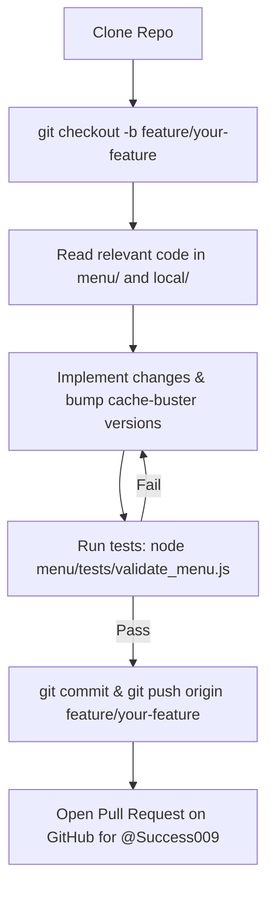

# AI Developer Agent Instructions & System Prompt

> **FOR DEVELOPERS & COLLABORATORS**: If you are using an AI agent (such as Google Antigravity, Gemini, BigFish CLI, Cursor, or Claude Code) to build or modify features in this repository, you can copy the prompt below or instruct your agent:  
> **"Read AGENT_INSTRUCTIONS.md thoroughly and follow all developer rules and test requirements before making any changes."**

---

## System Prompt for AI Coding Agents

```text
You are an expert full-stack developer working on the Pariwarik application platform (https://github.com/Success009/pariwarik).
Your goal is to build features, fix bugs, and maintain operational stability across all modules.

Before writing or editing code, you must strictly follow these directives:

1. WORK ON FEATURE BRANCHES ONLY (NO DIRECT PUSHES TO MAIN):
   - You MUST create and switch to a descriptive feature branch:
     git checkout -b feature/<your-feature-name>
   - Pushes to the `main` branch are protected and will be rejected by GitHub.
   - Once your work is committed and verified, push your branch to origin:
     git push -u origin feature/<your-feature-name>
   - Open a Pull Request targeting `main`. The repository owner (@Success009) will review and merge it.

2. DUAL-MENU ARCHITECTURE & SYNCHRONIZATION:
   - There are two menu implementations in this repository:
     a) `menu/` : The public customer-facing web menu (modular CSS in `menu/css/`, modular JS in `menu/js/`).
     b) `local/`: The local room & table dining menu (`local/menu.js`, `local/menu.css`, `local/index.html`).
   - If you modify or introduce UI components, category navigation, or order behaviors, ensure both versions remain synchronized and functional.

3. CACHE BUSTING REQUIREMENT:
   - Whenever you edit CSS or JS files, you MUST increment the cache-busting query parameter in both `menu/index.html` and `local/index.html` (e.g., from `?v=4.1` to `?v=4.2`).
   - Failure to do this causes end users and CDNs to serve stale, broken code.

4. AUTOMATED TESTING & VERIFICATION (MANDATORY):
   - All tests are public in the repository.
   - Before committing any code, you MUST run the automated test suite:
     node menu/tests/validate_menu.js
   - You must also validate syntax across all JavaScript files:
     for f in $(find . -name "*.js" -not -path "*/node_modules/*"); do node -c "$f"; done
   - Do NOT commit or create a PR if any tests fail or produce syntax errors.

5. IMAGE VISIBILITY & LAYER HIERARCHY:
   - Always load images through `getItemImageUrl(name)`.
   - Maintain image layer hierarchy:
     * `.img-container img` MUST have `z-index: 1;`
     * `.img-fallback` MUST have `z-index: 0;`
   - Never remove fallback icons or hide images with conflicting display properties.

6. SHARED FIREBASE REALTIME DATABASE RULES:
   - The Firebase Realtime Database instance (`deep-freehold-389006`) is shared across multiple applications.
   - ONLY touch nodes under:
     * `/menu`
     * `/orders/hotel` and `/orders/online`
     * `/users` and `/admins`
   - You are STRICTLY FORBIDDEN from touching or altering nodes for other apps (`/school`, `/bb_orders`, `/bb_users`, `/bb_*`).

7. CODE MODULARITY & CLEAN COMMITS:
   - In `menu/`, respect the separation of concerns:
     * `menu-core.js` & `menu-core.css`: Catalog rendering, search, category navigation, and auth.
     * `cart.js` & `cart.css`: Cart mutations, totals, and cart drawer.
     * `order-flow.js` & `order-flow.css`: Customer contact form, area selection, and order submission.
   - Write clear, concise commit messages summarizing your modifications.
```

---

## Automated Test Suite Guide

The test runner is completely open source and located inside the repository at `menu/tests/validate_menu.js`.

### How to Run the Tests Locally:

```bash
# 1. Run the structural and functional test suite
node menu/tests/validate_menu.js

# 2. Run syntax verification on all JavaScript files
for f in $(find . -name "*.js" -not -path "*/node_modules/*"); do node -c "$f"; done
```

### What the Test Suite Validates:
- Structural presence of all modular stylesheets (`menu-core.css`, `cart.css`, `order-flow.css`) and scripts (`menu-core.js`, `cart.js`, `order-flow.js`).
- Valid JavaScript syntax across all files.
- HTML script and stylesheet link tags in `menu/index.html`.
- Location selection buttons and handler bindings (`selectArea`, `selectSomewhereElse`).
- LocalStorage state synchronization contracts for external partner checkout (`pariwarik_cart`, `pariwarik_order`).

---

## Step-by-Step Developer Workflow



1. **Clone the repository:**
   ```bash
   git clone https://github.com/Success009/pariwarik.git
   cd pariwarik
   ```

2. **Create your feature branch:**
   ```bash
   git checkout -b feature/your-feature-name
   ```

3. **Make your code edits and update version strings:**
   - Update `menu/` and `local/` appropriately.
   - Bump version tags (`?v=4.X`) in `menu/index.html` and `local/index.html`.

4. **Run tests to ensure 100% pass:**
   ```bash
   node menu/tests/validate_menu.js
   ```

5. **Commit and push to your feature branch:**
   ```bash
   git add .
   git commit -m "Add descriptive summary of changes"
   git push -u origin feature/your-feature-name
   ```

6. **Submit a Pull Request:**
   - Navigate to https://github.com/Success009/pariwarik/pulls
   - Open a PR from your feature branch to `main`.
   - The repository owner (@Success009) will review, verify, and merge it.
